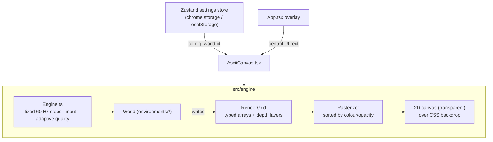

# Pixora — Architecture

> Version 1.2.0 · Chrome / Edge / Brave, Manifest V3 new-tab override

Pixora is a React overlay (clock, greeting, search, shortcuts, weather, settings) on top of a full-screen canvas driven by a small, dependency-free TypeScript engine. React only pushes settings into the engine; the engine never causes a React render.



## Source layout

```text
src/
├── App.tsx                         overlay layout; passes the central UI box to the canvas
├── data/worlds.ts                  world names, taglines, how-to-play text
├── store/useSettingsStore.ts       settings, migrations, daily rotation, Keep this forever
├── components/
│   ├── canvas/AsciiCanvas.tsx      creates the Engine once, syncs config + calm-zone rect
│   ├── worlds/WorldBar.tsx         prev/next world + "Keep this forever" switch + hint
│   ├── gallery/EnvironmentGallery  live snapshot previews (Engine.renderSnapshot)
│   ├── settings/SettingsDrawer     all preferences
│   ├── converter/                  ASCII Studio (image → text)
│   ├── search/, shortcuts/, widgets/, greeting/
│   └── common/useEscape.ts         Esc-to-close for panels
├── services/                       search (URL detection, bangs), weather (Open-Meteo), storage
└── engine/
    ├── core/
    │   ├── Engine.ts               loop, sizing, input, reduced motion, adaptive tier, snapshots
    │   ├── RenderGrid.ts           glyph / colour / alpha / bg / layer / focus arrays
    │   ├── Rasterizer.ts           counting-sort by (opacity, colour) → few state changes
    │   ├── Charsets.ts             ramps (re-sorted by measured ink), arrows, stroke glyphs
    │   ├── Color.ts                packed RGB helpers, gradient LUTs, hash
    │   └── PaletteManager.ts       theme LUTs and backdrop tints
    ├── draw/
    │   ├── Field.ts                scalar field → glyph ramp or Braille (bilinear + dither)
    │   └── Shapes.ts               anti-aliased creature bodies, stroke lines, spots
    ├── physics/                    Boids (spatial hash), wave equation, energy field, simplex noise
    └── environments/               the five worlds + registry
```

## Engine loop

- **Fixed timestep.** `requestAnimationFrame` accumulates real time; the world is stepped in 1/60 s increments (max 4 per frame, then the backlog is dropped). Animation speed scales the step `dt`. Behaviour is identical on 60, 120 and 144 Hz displays.
- **Input.** Pointer events are tracked on the window but only count as "on the art" when the target is the canvas, so hovering the search bar or a panel never scatters fish. Clicks are queued and consumed by the next step. Pointer velocity is smoothed (px/s).
- **Visibility.** The loop stops on `visibilitychange` (hidden tab = 0% CPU).
- **Reduced motion.** The setting or the OS preference runs 180 steps and draws one still frame; it redraws on resize, world or setting changes.
- **Sizing.** Font size ÷ density gives the glyph size; the cell width is the measured width of `M` in the real font, so glyphs never overlap. Grids, populations and layouts are rebuilt whenever the cell grid changes (window resize, font, density).
- **Fonts.** Inter and JetBrains Mono are bundled (Latin subsets). The engine waits for `document.fonts.load`, then re-measures and re-sorts ramps by the ink each glyph actually lays down.
- **Adaptive tier (`auto`).** If a frame's work averages above ~11 ms for ~1.5 s, the engine drops to 30 fps; if that's still slow, it uses a coarser grid. `low` starts there; `high` raises populations.

## Grid and layering

Each cell has a code point, packed colour, opacity, optional background fill, a **layer** and a **focus** multiplier. Writes are depth-tested (`SKY < FAR < MID < NEAR < FRONT < FX`), so draw order inside a world doesn't matter for correctness. The focus mask fades cells softly behind the central UI (the "calm zone").

## Rasterizer

1. Each visible cell gets a 15-bit key: 3 bits opacity + 4 bits per colour channel (theme LUT applied first for non-true-colour themes).
2. Counting sort by key → `globalAlpha` changes ≤ 8 per pass, `fillStyle` once per distinct colour.
3. Pass 1 fills solid cell backgrounds (creature bodies), pass 2 draws glyphs with `fillText`. Braille cells are drawn as up to eight small `fillRect` dots, which is far cheaper than glyphs and looks identical in any font.
4. The backdrop gradient + vignette is CSS on the canvas element; the canvas is cleared to transparent each frame, so the compositor paints the background at no cost.

A glyph-atlas (`drawImage`) path was prototyped and measured slower than `fillText` on software-rendered canvases, so it was dropped.

## Drawing helpers

- **Fields** (`draw/Field.ts`): water, light, aurora and trails are per-cell values 0..1. Text styles map them through an ink-sorted ramp (or a world's own ramp in *Auto*, e.g. vertical rays for the aurora). Braille bilinearly samples the field at 2×4 dots and thresholds each dot against an ordered-dither matrix. Flow writes straight into a dot-resolution buffer (`renderBrailleDots`) so its lines are one dot thin.
- **Bodies** (`draw/Shapes.ts`, after ascii-animals): a creature is a sampler `f(u, v)` in body space (u along the heading, v across). Each cell is sampled at five points: well-covered cells get a textured glyph (chosen by a hash of the body-space cell so texture travels with the animal) plus an optional darker fill; partially covered cells get soft edge glyphs (`: . ' ·`). Used for big fish, koi, frogs and lily pads.
- **Lines**: stroke glyphs `- \ | /` by angle, sampled every half cell — tentacles, kelp, reeds, dragonflies, coral, meteors.

## Physics

- **Boids**: flat typed arrays, uniform spatial hash, depth-aware neighbours (only similar depths flock together), pointer avoidance, startle with temporary speed boost, optional food attraction.
- **Wave equation**: `u' = (2u − u_prev + c²∇²u)·damping`, with the vertical half of the Laplacian weighted by (cellWidth/cellHeight)² so ripples stay circular on screen.
- **Energy field**: decaying, optionally diffusing per-cell scalar for wakes and glow.
- **Curl noise** (Flow): velocity = (∂n/∂y, −∂n/∂x) of 3D simplex noise, computed in aspect-corrected units.

## Worlds

| World | Layers (back → front) |
| :--- | :--- |
| Underwater | light shafts + caustics · marine snow · wake field · far kelp · fish by depth (far `›`, mid `><>`, near species) · jellyfish (dome bell, verlet tentacles) · big fish bodies · bubbles · seabed, coral, vents, front kelp |
| Moonlit Lake | stars · moon + halo · pine treeline · normal-shaded water + moon path · treeline reflection · petals · rain + splashes · fireflies |
| Frog Pond | murky water + ripples · koi (fogged) · food · lily pads + flowers · frogs (idle / anticipate / jump / swim / tongue) · dragonflies · reeds |
| Northern Lights | stars + reflections · two aurora curtains · lake mirror · meteors · ridged far + near mountains |
| Flow Fields | dot-resolution trails · direction arrows · click shockwave rings |

Each world declares a `preferredStyle` (used when Character Style is *Auto*) and a backdrop gradient, and re-seeds itself on resize.

## Settings and persistence

Settings live in `chrome.storage.local` (falling back to `localStorage` in dev) under `pixora_user_settings_v1`. Only known keys are saved. On load, old values are migrated (removed character styles → *Auto*, the old San Francisco default → empty city). Daily rotation runs on the **local** date; when **Keep this forever** is on, rotation is skipped.

## Measured cost (1440×900, 14 px font, software-rendered canvas, headless)

| World | Simulate + compose | Cells drawn |
| :--- | :--- | :--- |
| Underwater | ~3 ms | ~2,500 |
| Moonlit Lake | ~2 ms | ~3,250 |
| Frog Pond | ~3.5 ms | ~3,350 |
| Northern Lights | ~2.5 ms | ~3,600 |
| Flow Fields | ~2 ms | ~4,000 (mostly dots) |

Drawing dominates; on a GPU-backed canvas it's several times cheaper than in the headless numbers above.
