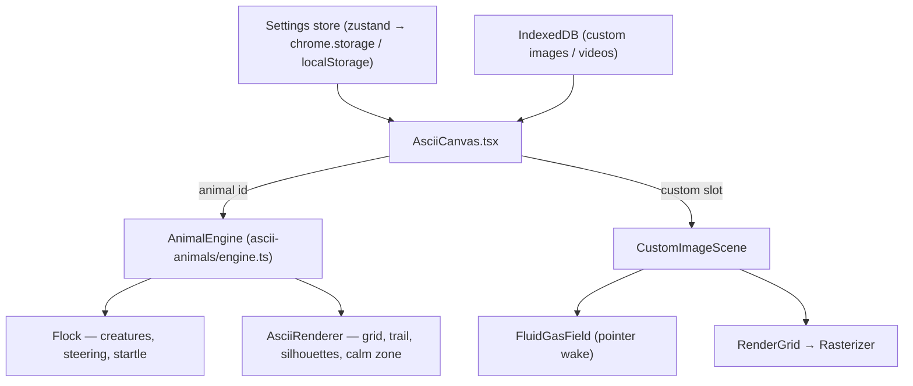

# Pixora — Architecture

> Version 2.2.x · Chrome / Edge / Brave, Manifest V3 new-tab override

Pixora is a React overlay (clock, greeting, search, shortcuts, weather, top bar, settings drawer) on top of one full-screen canvas. The canvas shows one of two kinds of scene:

| Kind | Code | What it is |
| :--- | :--- | :--- |
| **Animal** (7) | `src/engine/ascii-animals/` | Butterflies, Koi, Jellyfish, Dragonflies, Frogs, Cranes, Crabs. Ported from [ascii-animals](https://github.com/DesignerStephen1/ascii-animals) (MIT, licence kept in that folder). |
| **Custom** (3 slots) | `src/engine/environments/CustomImageScene.ts` | Your own image or looping video turned into ASCII, with a fluid-gas or ripple pointer effect. |

`src/data/catalog.ts` lists the ten scenes (id, name, kind). `activeScene` in settings picks one.

## Animals (`engine/ascii-animals/`)

- `engine.ts` — `AnimalEngine`: fixed 1/60 s steps (max 4 per frame), resize, click-to-startle on the canvas only, pauses when off-screen, a settled still frame under reduced motion. `set(key, value)` applies a tweak live.
- `flock.ts` — `Flock` holds the creatures and the shared steering; `SHARED_CONTROLS` are the knobs every animal has (density, speed, size, sway, spread, depth…), shown in the drawer next to each animal's own.
- `animals/*.ts` — one file per species: defaults, controls, behaviour, and a `draw` that paints through the `Pen`.
- `renderer.ts` — `AsciiRenderer`: cached background plus faint cell grid, a diffusing trail field, then silhouettes rasterised cell by cell (solid tiles with a glyph, soft edge glyphs, angled line glyphs).
- **Pixora addition — calm zone:** `setCalm(rect)` lays the plain background back over the clock/search column with a soft elliptical mask after each frame, so animals fade behind the text. `AsciiCanvas` measures the column (`focusRef`'s first child) and turns the zone off in Zen mode.
- **Pixora addition — GPU cells:** the engine adds two layers after the canvas: a WebGL canvas where `renderer.drawCellsGL` draws the cells through `core/GlyphGL` (glyph nudged 1 px down and tiles inset 0.5 px to match the 2D look), and a calm-zone canvas above it. The 2D canvas keeps the background, grid and trail. Main-thread cost per frame at 1440×900 dropped 1.4–3.2× (e.g. jellyfish 11.3 → 3.6 ms). If WebGL2 is missing or the context is lost, the layers are removed and `drawCells` (canvas 2D) runs as before.
- **Pixora addition — weather and time (`atmosphere.ts`):** `engine.setAtmosphere(input)` (or null for the scene as designed). Each frame the `Atmosphere` moves its particles and draws into the cell grid *before* the animals, so they sit in front: rain as `renderer.line` streaks (glyph from the angle, so wind slants them), or splash rings `' o .` on animals flagged `water` (koi, frogs), which also get ripples stamped into the trail field; snow as `. + *`; a jagged lightning bolt plus a short backdrop flash in storms; twinkling stars on clear dark-theme nights. Animals flagged `underwater` (jellyfish) skip all of that. Fog adds to `fade()`, the backdrop becomes a top → bottom sky gradient for the time of day (repainted when light, glow or weather moves on), and `turn()` grades colours (dimmer and bluer at night, warmer at golden hour). Wind pushes each creature sideways in `Flock.move` by the animal's `wind` exposure (butterflies 1, dragonflies 0.5, cranes 0.35).
  `services/atmosphereInput.ts` builds the input from the weather widget's last fetch (Open-Meteo weather code → kind and intensity, wind speed and direction, sunrise and sunset) or from the drawer's previews (live store, not saved), refreshed every 30 s.
- **Pixora addition — low power and capture:** `setLowPower(on)` caps drawing at 30 fps (the simulation still steps at 60 Hz) and uses 1× pixel density; `onFrameCost` reports each frame's work time; `capture()` draws a fresh frame and returns it composited into one canvas.

## Custom slots (`environments/CustomImageScene.ts`)

The media lives in IndexedDB (`services/imageStore.ts`, one entry per slot). `image-converter/AsciiQuality.ts` does the sampling and glyph choice (techniques studied in asciify-engine, MIT, and reimplemented):

- **Linear-light supersampling:** 3×3 (video 2×2) pixels per sample, averaged in linear light.
- **Measured ramp:** symbol glyphs measured for ink in JetBrains Mono, keeping ~20 evenly spaced tones.
- **Bayer 4×4 blend** near the midpoint between two glyphs of similar ink, plus **hysteresis** (a cell keeps its glyph within a small margin) against shimmer. Glyphs far apart in ink (`o # @`) snap instead of dithering, which would read as a woven pattern. The ramp is symbols only: no directional glyphs (stripes in skies) and no letters or digits (`$ 0 8 & %` read as text).

`image-converter/ShapeMatch.ts` adds structure:

- **Shape matching:** Characters mode samples 3×5 sub-cells per cell. Each stroke-like glyph's 3×5 coverage is measured once at the real cell size. Where a cell has contrast, the glyph is picked by tone error plus (1 − correlation) of the ink layouts, among glyphs of similar ink. Letters and digits are excluded so pictures don't read like text, and so long edges don't become columns of `J` or `L`.
- **Edge outlines:** Sobel gradients feed a structure tensor that is blurred twice, gated by coherence and thresholded at mean + 1.1σ, then thinned by non-maximum suppression. The ridges are inked in, scaled by the *Edge Outlines* slider. Video refreshes edges every other frame.

Measured at 1440×900 in Chrome: a still picture builds in about 24 ms (once), a video frame in about 11 ms, and `render()` takes about 2.5 ms.

Videos are re-sampled once per decoded frame (`requestVideoFrameCallback`, falling back to `currentTime`) and pause while the tab is hidden or motion is reduced. Animated GIF / WebP / APNG / AVIF go through `image-converter/AnimatedImage.ts`: the WebCodecs `ImageDecoder` decodes one frame at a time as it falls due (0–10 ms delays become 100 ms, as browsers do), and the scene re-samples once per new frame. Without `ImageDecoder` the slot shows the first frame through a plain ``.

Light theme: Characters and Braille draw darkness, so the tone ramp is inverted and colours go through `inkOnPaper` (`core/Color.ts`: at most ~34% luminance, hue kept, a little extra saturation); glow tiles become a pale tint. Tiles and Blocks keep the photo's own colours as a mosaic on white. Low power samples without supersampling and refreshes video edges every third frame. A still picture redraws at ~12 fps for its slow drift, or holds the frame under reduced motion.

Render modes: Characters, Braille, Tiles, Blocks; colour modes from true colour to monochrome; brightness/contrast/gamma and a backlight glow. Pointer effects: gas (`physics/FluidGasField.ts`, semi-Lagrangian advection with vorticity and plume spread), travelling ripples, drift, or the **lantern** (a lagged Gaussian light with a 12-point fading trail, per-cell grain, a warm colour shift and a little rim flicker). Cells go into `core/RenderGrid` (typed arrays).

`core/GlyphGL.ts` draws them with WebGL2 on a transparent layer above the backdrop canvas. It packs each lit cell into one 20-byte instance (column, row, atlas slot, glyph RGBA, tile RGBA), uses a lazily filled glyph atlas drawn with the same font and centring, and draws Braille as dots, all in one `drawArraysInstanced`. A full 1440×900 picture takes about 4 ms, against about 17 ms for the 2D path. If WebGL2 is missing or the context is lost, `core/Rasterizer` (canvas 2D, batched by colour and opacity) takes over.

## UI

- `App.tsx` — layout, hotkeys (`Z` Zen, `S` settings, `P` save frame, `Esc`, `← →`/`[ ]` and `1`–`0` for scenes, via `stepScene` / `sceneForKey` in `data/catalog.ts`), drag-and-drop of media onto the page (into the slot you're viewing, else the first empty one).
- `navigation/TopBar.tsx` — weather, the always-visible scene chip (‹ name n/10 ›; click for the full list, which also opens on top-edge hover), save-frame, Zen and settings buttons.
- `services/capture.ts` — the live scene registers a capturer; `saveFrame` turns its canvas into a PNG download named `pixora-<scene>-<date>-<time>.png`.
- `services/power.ts` — low power. `auto` turns on while on battery (Battery Status API) or once frames have averaged over 18 ms of work for 3 s in a visible tab (`SlowFrameMeter`); `on`/`off` force it. Browsers don't expose the OS battery-saver switch.
- `services/theme.ts` — resolves `appearance` (system/dark/light) against `prefers-color-scheme`, sets `<html data-theme>` and caches the result in `localStorage` so the next tab opens without a flash.
- `drawer/EdgeHoverDrawer.tsx` — all settings: animal tweaks, custom slot media and look, search, shortcuts, weather, display toggles, reset to defaults.
- `widgets/`, `search/`, `shortcuts/`, `greeting/` — the productivity overlay.

## Theme

The UI was written for dark: `white` text, `slate` greys and pale accent shades. `tailwind.config.js` points those colour names (and `canvas`, `surface`, `surface-2`) at CSS variables generated from Tailwind's own palette. `[data-theme="light"]` swaps them: `white` becomes slate-900 ink, `black` becomes white, the slate scale flips (300 ↔ 700…) and the accents' pale shades (200–500) become their deep versions. The glass panels in `index.css` use the same variables. Components keep their classes.

## Settings and persistence

Saved under `pixora_user_settings_v2` in `chrome.storage.local` (or `localStorage` in dev). On load:

- If only the v2.0 key (`pixora_user_settings_v1`) exists, its shortcuts, name, search engine, weather and display preferences carry over; the last animal viewed becomes the scene. v2.0 animal tweaks are dropped (different knob names).
- Unknown keys and values of the wrong type are ignored, and a scene id that no longer exists (a v2.0 world or flow) falls back to the default animal.

## Weather

`services/weatherService.ts` uses Open-Meteo (forecast and geocoding). With *Use my location* on, the place name comes from BigDataCloud's reverse geocoder. Without a city, the browser's time zone gives one.

## Tests

`pnpm test` runs Vitest on `tests/`: settings loading and v2.0 migration, scene stepping and number keys, frame file names, the low-power decision and slow-frame meter, theme resolution, GIF frame timing, glyph choice (including a check that flat bright skies never weave `#@#@`), shape matching, edge detection and light-theme ink colours. GitHub Actions runs the tests and the build on every push to main.

## Build and release

`pnpm build` (tsc + Vite) writes `dist/`. `pnpm package:release` rebuilds and zips `dist/` with forward-slash paths into `release/pixora-v<version>-chrome-extension.zip` and `release/pixora-chrome-extension.zip`. `public/THIRD_PARTY_NOTICES.txt` ships inside the zip.
