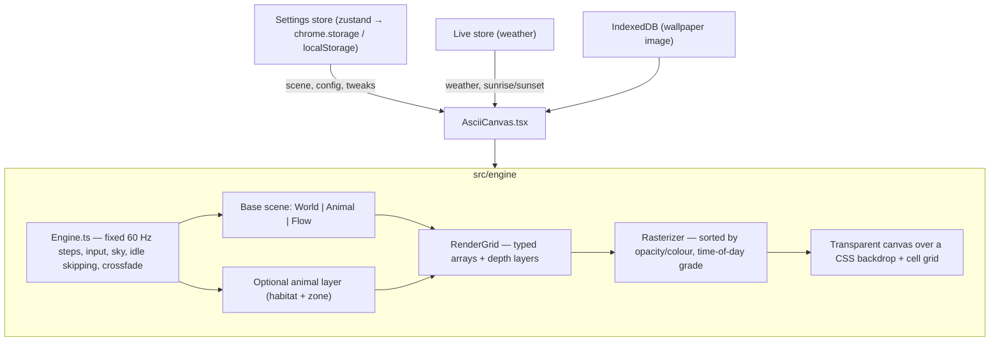

# Pixora — Architecture

> Version 2.0.0 · Chrome / Edge / Brave, Manifest V3 new-tab override

Pixora is a React overlay (clock, greeting, search, shortcuts, weather, panels) on top of a full-screen canvas driven by a small, dependency-free TypeScript engine. React only pushes settings into the engine; the engine never causes a React render.

## Scenes

Three kinds of scene, one `IEnvironment` interface (`src/types/environment.ts`):

| Kind | Folder | What it is |
| :--- | :--- | :--- |
| **World** | `engine/environments/` | Scenery and atmosphere, no main creatures. Exposes a `habitat()` (sky / water / ground) for layered animals. 10 worlds plus **Your Image**. |
| **Animal** | `engine/animals/` | One species, built on the animal kit. Alone on a clean dark grid, or layered over a world. 10 animals. |
| **Flow** | `engine/flows/` | Generative line art at Braille-dot resolution. 6 flows. |

`data/catalog.ts` lists every scene with its name, hints, accent colour, `ready` flag, and either **world traits** (water, sky, ground, flowers, season, time) or **animal needs**. `fits(world, animal)` compares them; the gallery, settings and daily rotation only ever offer pairs that fit, and greyed-out options show the reason ("Koi need open water").

## Engine loop (`engine/core/Engine.ts`)

- **Fixed timestep:** real time accumulates and the scene is stepped at 1/60 s (max 4 steps a frame). Speed is identical at 60/120/144 Hz; animation speed scales the step.
- **Base + overlay:** `setScene(base, overlay)` swaps scenes with a 0.7 s **crossfade** (a captured copy of the last frame, backdrop included, fades out over the new one). The overlay's context carries the base's habitat narrowed to the animal's zone (`zoneOf`).
- **Input:** pointer only counts when its target is the canvas (hovering the search bar never scatters fish); clicks queue until the next step; velocity is smoothed.
- **Idle skipping:** scenes can report `idle()`; while idle (and nothing else changed) the engine keeps the last frame. Your Image uses this when nothing moves.
- **Sky:** every ~20 s the engine computes light/warmth from local time and the day's sunrise/sunset (Open-Meteo, fallback 06:15/18:30). Clock-following worlds get a blended day/night backdrop and a colour grade applied in the rasterizer's colour table.
- **Adaptive quality (`auto`):** sustained heavy frames → 30 fps → coarser grid. Hidden tab → loop stops. Reduced motion → a settled still frame.
- **Sizing:** cell width is the measured width of the real font; the grid re-seeds scenes on resize; the UI box (clock/search/shortcuts) is passed as `safe` so big scenery stays clear of it, and the art fades behind it (calm zone).

## Grid and rasterizer

- `RenderGrid` stores per cell: code point, colour, opacity, background fill, **layer** (`SKY < FAR < MID < NEAR < FRONT < FX`, depth-tested) and a focus multiplier. Glyph writes never erase a tile beneath them.
- `Rasterizer` counting-sorts cells by (opacity level, 12-bit colour) so each frame sets `globalAlpha` ≤ 8 times and `fillStyle` once per colour. Tiles are filled with a hairline gap; Braille cells are drawn as dot rectangles; other glyphs with `fillText`. The backdrop gradient and the faint cell grid are CSS on the canvas element. (A `drawImage` glyph atlas was measured slower than `fillText` on software canvases and dropped.)

## Drawing helpers (`engine/draw/`)

- **Fields** (`Field.ts`): per-cell values 0..1 rendered as **tiles** (quantised translucent cells, opacity ∝ value²), text ramps (sorted by measured ink), or Braille (bilinear 2×4 sampling + ordered dither). `renderBrailleDots` draws a dot-resolution buffer directly.
- **Shapes** (`Shapes.ts`): `drawBody` samples a body-space shape function 5× per cell → solid tiles (glyph texture anchored to the body) or soft edges; `drawPolygon` fills polygons as tiles; `drawLine` uses `- \ | /` by angle.

## Animals (`engine/animals/`)

`kit.ts` (ideas after [ascii-animals](https://github.com/DesignerStephen1/ascii-animals), reimplemented): a shared **course** with upstream re-entry, per-creature **depth** (size, speed, haze), **population** scaled to habitat area, helpers for turning and separation, and **knobs**. `AnimalBase` merges shared knobs (how many, size, speed, depth range, haze) with each animal's own; the Tweaks panel edits them and population knobs re-seed live. Each animal declares a `zone` (sky / water / ground / any).

## Flows (`engine/flows/`)

`FlowBase`: an ink buffer at Braille-dot resolution that fades, particle advection through `velocityAt` in isotropic cell units, drifting mood palettes, Braille or text rendering.

| Flow | Technique |
| :--- | :--- |
| Curl Currents | curl of 3D simplex noise |
| Magnetic Lines | 2D monopole field from drifting ± poles; particles born at + poles, retired at − poles |
| Wind Map | wavy westerly + Gaussian vortex pressure cells (H/L) |
| Strange Attractor | Clifford map iterated ~6000×/frame; collapse detection steers back to a chaotic preset |
| Contours | band edges of a noise height field, examined only in cells that straddle a level |
| Vortex Street | point vortices shed alternately by posts in a uniform current + potential flow past cylinders |

## Your Image (`environments/ImageWorld.ts`)

The picture lives in IndexedDB (`services/imageStore.ts`) and is decoded with `onload` (not `decode()`, which never settles in background tabs). On (re)build it is cover-cropped to the screen, sampled at cell / half-cell / Braille-dot resolution, toned with the Studio pipeline (auto-levels, brightness, contrast, gamma, invert) and stored per cell. Effects: ripple (sampling displaced by a wave simulation's gradient), repel, reveal lens (true photo colours), drift.

## Time of day and weather

`engine/core/Sky.ts` computes `{ light, warm, phase }`. Worlds with `followsClock` provide `backdropDay`; the engine blends backdrops and grades colours, and worlds read `ctx.sky` / `ctx.weather` for their own touches (sun vs moon, windows off by day, rain on the lake and pond, fog thickening mist, more lightning in storms). The weather widget publishes Open-Meteo data (coarse kind + sunrise/sunset) through `store/useLiveStore.ts`.

## Settings and persistence

`chrome.storage.local` (or `localStorage` in dev) under `pixora_user_settings_v1`; only known keys are saved; older settings migrate (single world → three categories, removed styles → Auto). Daily rotation runs on the local date per category with its own pin; Your Image is never rotated away.

## ASCII Studio (`engine/image-converter/ImageProcessor.ts`)

High-quality downscale, auto-levels and tone controls, then Characters (ramp + optional edge strokes), Braille (Atkinson dither) or Blocks (half-blocks with separate top/bottom colours), each keeping per-cell colour. Exports text and PNG.

## Measured cost

Headless check, 1440×900, all scenes after 4 s with a pointer sweep and a click: average simulate + compose 0.05–5.5 ms per frame (Contours highest), no errors or NaNs in any of the 27 scenes or 28 allowed layered pairs; the same at 390×844. Drawing costs extra and depends on how many cells are lit.
