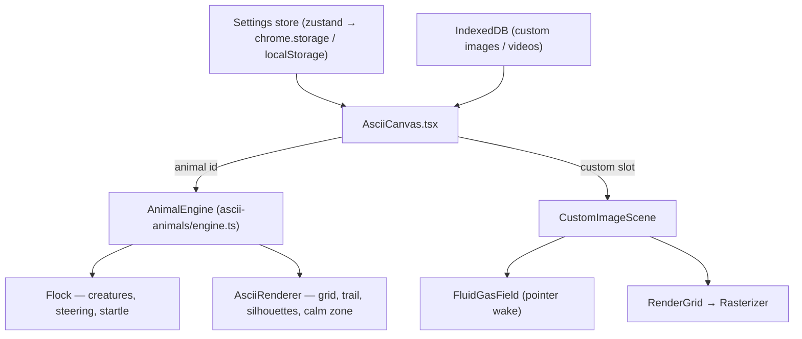

# Pixora — Architecture

> Version 2.1.x · Chrome / Edge / Brave, Manifest V3 new-tab override

Pixora is a React overlay (clock, greeting, search, shortcuts, weather, top bar, settings drawer) on top of one full-screen canvas. The canvas shows one of two kinds of scene:

| Kind | Code | What it is |
| :--- | :--- | :--- |
| **Animal** (7) | `src/engine/ascii-animals/` | Butterflies, Koi, Jellyfish, Dragonflies, Frogs, Cranes, Crabs. Ported from [ascii-animals](https://github.com/DesignerStephen1/ascii-animals) (MIT, licence kept in that folder). |
| **Custom** (3 slots) | `src/engine/environments/CustomImageScene.ts` | Your own image or looping video turned into ASCII, with a fluid-gas or ripple pointer effect. |

`src/data/catalog.ts` lists the ten scenes (id, name, kind). `activeScene` in settings picks one.

## Animals (`engine/ascii-animals/`)

- `engine.ts` — `AnimalEngine`: fixed 1/60 s steps (max 4 per frame), resize, click-to-startle on the canvas only, pauses when off-screen, a settled still frame under reduced motion. `set(key, value)` applies a tweak live.
- `flock.ts` — `Flock` holds the creatures and the shared steering; `SHARED_CONTROLS` are the knobs every animal has (density, speed, size, sway, spread, depth…), shown in the drawer next to each animal's own.
- `animals/*.ts` — one file per species: defaults, controls, behaviour, and a `draw` that paints through the `Pen`.
- `renderer.ts` — `AsciiRenderer`: cached background plus faint cell grid, a diffusing trail field, then silhouettes rasterised cell by cell (solid tiles with a glyph, soft edge glyphs, angled line glyphs).
- **Pixora addition — calm zone:** `setCalm(rect)` lays the plain background back over the clock/search column with a soft elliptical mask after each frame, so animals fade behind the text. `AsciiCanvas` measures the column (`focusRef`'s first child) and turns the zone off in Zen mode.

## Custom slots (`environments/CustomImageScene.ts`)

The media lives in IndexedDB (`services/imageStore.ts`, one entry per slot). `image-converter/AsciiQuality.ts` does the sampling and glyph choice (techniques studied in asciify-engine, MIT, and reimplemented):

- **Linear-light supersampling:** 3×3 (video 2×2) pixels per sample, averaged in linear light.
- **Measured ramp:** symbol glyphs measured for ink in JetBrains Mono, keeping ~20 evenly spaced tones.
- **Bayer 4×4 blend** between the two glyphs around each tone, plus **hysteresis** (a cell keeps its glyph within a small margin) against shimmer.

Videos are re-sampled once per decoded frame (`requestVideoFrameCallback`, falling back to `currentTime`) and pause while the tab is hidden or motion is reduced. A still picture redraws at ~12 fps for its slow drift, or holds the frame under reduced motion.

Render modes: Characters, Braille, Tiles, Blocks; colour modes from true colour to monochrome; brightness/contrast/gamma and a backlight glow. Pointer effects: gas (`physics/FluidGasField.ts`, semi-Lagrangian advection with vorticity and plume spread), travelling ripples, drift, or the **lantern** (a lagged Gaussian light with a 12-point fading trail, per-cell grain, a warm colour shift and a little rim flicker). Cells go into `core/RenderGrid` (typed arrays) and `core/Rasterizer` draws them batched by colour and opacity.

## UI

- `App.tsx` — layout, hotkeys (`Z` Zen, `S` settings, `Esc`, `← →`/`[ ]` and `1`–`0` for scenes), drag-and-drop of media onto the page (into the slot you're viewing, else the first empty one).
- `navigation/TopBar.tsx` — weather, the always-visible scene chip (‹ name n/10 ›; click for the full list, which also opens on top-edge hover), Zen and settings buttons.
- `drawer/EdgeHoverDrawer.tsx` — all settings: animal tweaks, custom slot media and look, search, shortcuts, weather, display toggles, reset to defaults.
- `widgets/`, `search/`, `shortcuts/`, `greeting/` — the productivity overlay.

## Settings and persistence

Saved under `pixora_user_settings_v2` in `chrome.storage.local` (or `localStorage` in dev). On load:

- If only the v2.0 key (`pixora_user_settings_v1`) exists, its shortcuts, name, search engine, weather and display preferences carry over; the last animal viewed becomes the scene. v2.0 animal tweaks are dropped (different knob names).
- Unknown keys and values of the wrong type are ignored, and a scene id that no longer exists (a v2.0 world or flow) falls back to the default animal.

## Weather

`services/weatherService.ts` uses Open-Meteo (forecast and geocoding). With *Use my location* on, the place name comes from BigDataCloud's reverse geocoder. Without a city, the browser's time zone gives one.

## Build and release

`pnpm build` (tsc + Vite) writes `dist/`. `pnpm package:release` rebuilds and zips `dist/` with forward-slash paths into `release/pixora-v<version>-chrome-extension.zip` and `release/pixora-chrome-extension.zip`. `public/THIRD_PARTY_NOTICES.txt` ships inside the zip.
