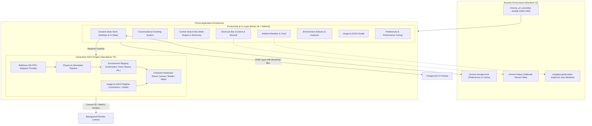
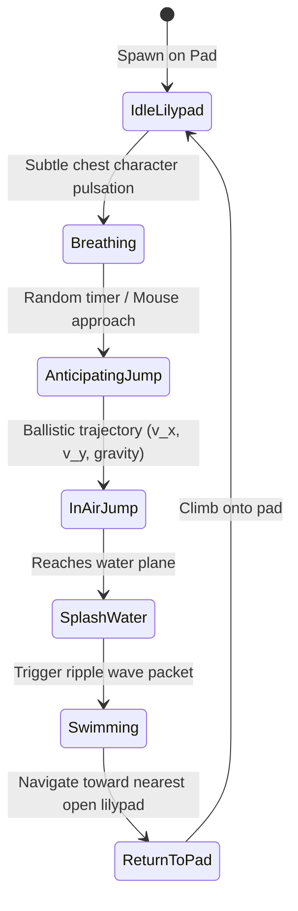
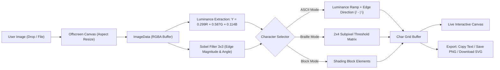

# Pixora — System Architecture & Technical Specification

> **Document Version:** 1.0.0  
> **Target Platforms:** Google Chrome, Microsoft Edge, Chromium Manifest V3  
> **Core Identity:** Generative ASCII-Art Animation Engine & Intelligent Minimalist Productivity Dashboard  

---

## 1. Executive Summary & Design Philosophy

Pixora transforms the ubiquitous browser New Tab into an ambient, living digital sanctuary. Instead of standard dashboard widgets against static wallpapers, Pixora is built on an **original high-performance character-based generative animation engine**, overlaid with a refined, tactile productivity interface inspired by **Claude's conversational warmth**, **Arc's fluid minimalism**, and **Linear's meticulous interaction polish**.

### Key Highlights
- **Decoupled Engine Core:** Pure TypeScript/Canvas 2D simulation loop running at up to 60 FPS, isolated from the React DOM tree for zero garbage-collection jitter.
- **Dual Rasterization Modes:** Character-Grid Direct Rasterization and Subpixel Braille Unicode ($2 \times 4$ dot matrix encoding for $8\times$ perceptual detail).
- **Living Ecosystems:** 5 distinct procedural worlds featuring Boids flocking, discretized wave equation ripples, biomechanical creature kinematics, and flow fields.
- **Image-to-ASCII Pipeline:** Real-time client-side luminance mapping, Sobel contour enhancement, and color quantization.
- **Zero-Latency Productivity:** Time-sensitive conversational greetings, omni-engine search with keyboard accelerators, privacy-first shortcuts, and cached ambient weather.

---



---

## 2. Directory & Folder Structure

The project is structured cleanly as a modern, modular Manifest V3 extension. It isolates UI state from high-frequency simulation routines:

```text
pixora/
├── manifest.json                   # Chrome/Edge Manifest V3 configuration
├── package.json                    # Dependencies & build scripts
├── vite.config.ts                  # Vite + CRX/Rollup extension bundler
├── tsconfig.json                   # Strict TypeScript configuration
├── tailwind.config.js              # Theme definitions & glassmorphism utilities
├── public/
│   ├── icons/                      # Extension icons (16, 32, 48, 128)
│   └── presets/                    # Sample starter images for ASCII converter
├── src/
│   ├── main.tsx                    # React application root entrypoint
│   ├── index.css                   # Tailwind styles, fonts & animations
│   ├── types/
│   │   ├── engine.ts               # Types for particles, grid, palettes, styles
│   │   ├── environment.ts          # Environment definition interfaces & lifecycles
│   │   ├── settings.ts             # User settings, search engines, performance
│   │   └── widgets.ts              # Weather, shortcuts, greeting types
│   ├── engine/
│   │   ├── core/
│   │   │   ├── Engine.ts           # Master coordinator: viewport, loop, canvas
│   │   │   ├── RenderGrid.ts       # Discrete 2D character/color buffer
│   │   │   ├── Charsets.ts         # ASCII, Braille, Blocks, Math, Matrix palettes
│   │   │   └── PaletteManager.ts   # Monochrome, Amber, Cyberpunk, True-Color
│   │   ├── rasterizers/
│   │   │   ├── Canvas2DRasterizer.ts   # Monospace font batch renderer
│   │   │   ├── BrailleRasterizer.ts    # 2x4 subpixel dot matrix bitfield encoder
│   │   │   └── WebGLRasterizer.ts      # (High-tier) Glyph atlas texture shader
│   │   ├── physics/
│   │   │   ├── Vector2D.ts         # Vector arithmetic, distance, lerp
│   │   │   ├── BoidsSystem.ts      # Flocking (Separation, Alignment, Cohesion)
│   │   │   ├── WaveEquation2D.ts   # Discretized 2D shallow water wave solver
│   │   │   ├── SimplexNoise.ts     # Fast 2D/3D continuous procedural noise
│   │   │   ├── FlowField.ts        # Vector force grid for particles
│   │   │   └── SpringChain.ts      # Soft-body kinematics for tentacles & seaweed
│   │   ├── environments/
│   │   │   ├── BaseEnvironment.ts  # Abstract lifecycle class (init, update, resize)
│   │   │   ├── UnderwaterWorld.ts  # Flocking fish, undulating jellyfish, seaweed
│   │   │   ├── InteractiveWater.ts # Heightfield ripple sim with cursor disturbance
│   │   │   ├── FrogPond.ts         # Biomechanical frogs, lily pads, insects
│   │   │   ├── CosmicAurora.ts     # Multi-octave aurora curtains & cosmic dust
│   │   │   ├── AbstractFlow.ts     # Morphing curl noise & harmonic attractors
│   │   │   └── RainForest.ts       # Weather-coupled rainfall, wind shear, fireflies
│   │   ├── image-converter/
│   │   │   ├── ImageProcessor.ts   # Downsampling, luminance extraction, Sobel edges
│   │   │   └── AsciiArtGenerator.ts# Converts ImageData to character grid & SVG/PNG
│   │   └── input/
│   │       └── InteractionManager.ts # Mouse position, velocity, clicks, ripples
│   ├── store/
│   │   ├── useSettingsStore.ts     # Zustand store synced with chrome.storage.local
│   │   └── useEnvironmentStore.ts  # Active environment, parameters, presets
│   ├── services/
│   │   ├── storageService.ts       # Abstract chrome.storage wrapper with fallback
│   │   ├── weatherService.ts       # Open-Meteo API client with caching & geocoding
│   │   ├── searchService.ts        # Engine registry, query formatter, suggestions
│   │   └── historyService.ts       # Optional chrome.history query manager
│   ├── components/
│   │   ├── common/
│   │   │   ├── Modal.tsx           # Accessible frosted glass modal dialog
│   │   │   ├── Slider.tsx          # Custom numeric tuning slider
│   │   │   └── Tooltip.tsx         # Contextual hint helper
│   │   ├── canvas/
│   │   │   └── AsciiCanvas.tsx     # React bridge to the standalone Engine instance
│   │   ├── greeting/
│   │   │   └── ConversationalGreeting.tsx # Time-aware conversational greeting
│   │   ├── search/
│   │   │   ├── CentralSearchBar.tsx# Main input, keyboard traps, instant dispatch
│   │   │   └── SearchEnginePicker.tsx # Dropdown engine selector
│   │   ├── shortcuts/
│   │   │   ├── ShortcutsBar.tsx    # Grid of pinned & recent shortcuts
│   │   │   ├── ShortcutItem.tsx    # Favicon, title, edit/remove triggers
│   │   │   └── AddShortcutModal.tsx# Custom shortcut creation
│   │   ├── widgets/
│   │   │   ├── AmbientClock.tsx    # Subtle digital/analog typography clock
│   │   │   └── WeatherWidget.tsx   # Temperature, icon, city, condition
│   │   ├── gallery/
│   │   │   └── EnvironmentGallery.tsx # Visual cards with live/instant previews
│   │   ├── converter/
│   │   │   └── ImageConverterModal.tsx # Upload, thresholding, palette & export
│   │   └── settings/
│   │       ├── SettingsDrawer.tsx  # Master preference tabs
│   │       ├── AppearanceSettings.tsx # Themes, styles, character sizes
│   │       ├── EngineSettings.tsx  # FPS target, density, particle caps
│   │       └── PrivacySettings.tsx # History/location toggles
│   └── utils/
│       ├── colors.ts               # RGB/HSL conversions and luminance math
│       └── formatters.ts           # Date, time, temperature units
```

---

## 3. Rendering-Engine Design: Character-Based Graphics

Rendering thousands of characters dynamically each frame requires a custom graphics architecture that bypasses the DOM entirely.

### 3.1 Dual-Level Buffering
Rather than drawing directly to screen primitives, the engine maintains a logical **Render Grid Buffer**:
$$\text{Grid}(x, y) = \{\text{char}: \text{codePoint}, \text{r}: [0..255], \text{g}: [0..255], \text{b}: [0..255], \text{alpha}: [0..1]\}$$

```
Simulation World Space (Continuous Coordinates: [0..W, 0..H])
                      │
                      ▼
Discretization & Mapping Pipeline
  ├── Position -> Cell (x / cellWidth, y / cellHeight)
  ├── Velocity / Normal -> Directional Character (/, \, |, -, ░, ▒, ▓, █)
  ├── Luminance -> Density Ramp (" .:-=+*#%@")
  └── Braille Bitfield -> 2x4 Subpixel Matrix (0x2800 + bits)
                      │
                      ▼
Logical Character Grid Buffer [Cols x Rows]
                      │
                      ▼
Rasterizer Dispatcher (Canvas 2D / WebGL Atlas)
                      │
                      ▼
Physical Screen (HTML5 Canvas)
```

### 3.2 Character Mapping Modes & Character Sets

1. **Standard ASCII (Luminance Gradient):**
   - 10-level: ` ` `.` `:` `-` `=` `+` `*` `#` `%` `@`
   - 70-level: `"$@B%8&WM#*oahkbdpqwmZO0QLCJUYXzcvunxrjft/\|()1{}[]?-_+~<>i!lI;:,\"^`'. "`
2. **Braille Subpixel Mode (Unicode `0x2800` - `0x28FF`):**
   - Each Braille character is a $2 \times 4$ dot grid.
   - For every character cell, the engine samples an internal $2 \times 4$ subpixel bitfield:
     $$\text{Unicode} = 0\text{x}2800 + (d_1 \cdot 1 + d_2 \cdot 2 + d_3 \cdot 4 + d_4 \cdot 64 + d_5 \cdot 8 + d_6 \cdot 16 + d_7 \cdot 32 + d_8 \cdot 128)$$
   - This provides **8× higher spatial resolution** for continuous curves, wave contours, and fine aquatic tentacles.
3. **Geometric & Block Elements:**
   - Half blocks (`▀`, `▄`), quadrants (`▖`, `▗`, `▘`, `▝`), and shades (`░`, `▒`, `▓`, `█`) for retro-chunky terminal aesthetics.
4. **Directional Flow Characters:**
   - Velocity vectors $(\vec{v}_x, \vec{v}_y)$ mapped to directional glyphs: `←`, `↖`, `↑`, `↗`, `→`, `↘`, `↓`, `↙`, `·`.

### 3.3 Aspect Ratio Correction
Monospaced font characters typically have a height-to-width ratio of approximately $1.8:1$ to $2.0:1$. Uncorrected rasterization causes circles (such as expanding water ripples) to appear as squashed vertical ellipses.  
Pixora enforces an **Aspect Ratio Normalizer**:
$$\Delta x = \text{fontSize} \times 0.60, \quad \Delta y = \text{fontSize} \times 1.0$$
$$\text{SamplingAspect} = \frac{\Delta x}{\Delta y} \approx 0.6$$
Calculations for radial distance ($r = \sqrt{\Delta x^2 + (\Delta y \times \text{aspect})^2}$) normalize geometry so procedural shapes retain true Euclidean proportions.

---

## 4. Animation & Physics Engine Design

All environments are driven by mathematical and biological simulations rather than pre-rendered assets.

### 4.1 Boids Flocking Simulation (Underwater Fish & Insect Swarms)
Each fish or insect is modeled with Craig Reynolds' classic steering formulation with additions for obstacle/cursor repulsion:
$$\vec{F}_{\text{total}} = w_1 \vec{F}_{\text{separation}} + w_2 \vec{F}_{\text{alignment}} + w_3 \vec{F}_{\text{cohesion}} + w_4 \vec{F}_{\text{cursor\_avoid}} + w_5 \vec{F}_{\text{wander}}$$

- **Cursor Scatter:** When the user's cursor approaches within radius $R_{\text{disturb}}$, an exponential repulsive force $\vec{F} = \frac{k}{(d + \epsilon)^2} \hat{r}$ scatters the school.
- **Secondary Swimming Motion:** Each fish computes an undulating tail character offset based on $\sin(\text{time} \times \omega + \phi)$, alternating between `>` `<` `~` `-`.

### 4.2 Kinematic Jellyfish Soft-Body Kinematics
- **Bell Oscillation:** The bell contracts sharply and expands smoothly:
  $$\text{Scale}_y(t) = 1.0 + 0.35 \times \max(0, \sin(\omega t))^3 - 0.15 \times \cos(\omega t)$$
- **Tentacle Chain Kinematics:** 4 to 8 tentacles per jellyfish modeled as verlet/spring damping chains attached to the bell rim:
  $$\vec{p}_{i}(t) = \vec{p}_{i}(t-1) + \vec{v}_i \Delta t + \vec{g}_{\text{buoyancy}} + \text{drag}(\vec{v}_i)$$
  Subject to distance constraints $||\vec{p}_{i} - \vec{p}_{i-1}|| = L_0$.

### 4.3 2D Discrete Wave Equation (Water Ripples & Pond Disturbance)
The surface of the water is simulated via a 2D scalar heightfield $u(x, y)$ solved with finite difference approximations:
$$u^{t+1}(x, y) = 2 u^t(x, y) - u^{t-1}(x, y) + c^2 \left( u^t(x-1, y) + u^t(x+1, y) + u^t(x, y-1) + u^t(x, y+1) - 4u^t(x, y) \right)$$
- **Damping:** Heights are multiplied each tick by a dissipation coefficient $\gamma = 0.985$ to ensure natural wave decay.
- **Interaction:**
  - Mouse moves inject velocity impulses: $u(x_m, y_m) \mathrel{+}= \Delta \text{mouse} \times 0.2$.
  - Mouse clicks trigger Gaussian impulse droplets: $u(x, y) \mathrel{+}= A \exp\left(-\frac{(x-x_c)^2 + (y-y_c)^2}{2\sigma^2}\right)$.
  - Frogs landing in the pond inject localized high-amplitude wave rings.

### 4.4 Biomechanical Frog State Machine


---

## 5. Image-to-ASCII Studio Architecture

The image converter allows users to upload any picture and render it into interactive or static ASCII/Braille artwork.



---

## 6. Productivity Dashboard & UX Integration

The productivity UI floats seamlessly over the generative canvas, following strict legibility and visual hierarchy rules.

### 6.1 Conversational Greeting Engine
- **Time Brackets:**
  - Morning (`05:00` - `11:59`): *"Good morning. Ready to explore something new?"*, *"The morning air is quiet. Where shall we begin?"*
  - Afternoon (`12:00` - `16:59`): *"Good afternoon. What are we working on today?"*, *"Hope your day is flowing smoothly."*
  - Evening (`17:00` - `21:59`): *"Good evening. Let's make something worthwhile."*, *"Winding down, or just hitting your stride?"*
  - Night (`22:00` - `04:59`): *"The night is young and quiet. What's on your mind?"*, *"Quiet hours. Breathe and take your time."*
- **Personalization:** Supports an optional user name (e.g., *"Good morning, Alex."*).
- **Anti-Repetition:** Rotates through seeded pools ensuring consecutive tab opens do not feel robotic.

### 6.2 Omnipresent Central Search Bar
- **Multi-Engine Support:** Google, Bing, DuckDuckGo, Brave Search, Ecosia, Yahoo, and customizable search URLs (e.g. `https://kagi.com/search?q=%s`).
- **Engine Switching Without Page Reload:** Clickable engine pill in the search bar or prefix bangs (e.g. `!d`, `!g`, `!b`).
- **Keyboard Navigation:** `/` focuses search instantly; `Esc` clears; `ArrowUp`/`ArrowDown` navigates suggestions or history.

### 6.3 Shortcuts Management
- **Manual Quick-Add:** Custom URL, title, automatic favicon resolution via `https://www.google.com/s2/favicons?domain=...&sz=64`.
- **Recently Visited Sites:** Uses `chrome.history.search` **only when enabled** by the user via an explicit opt-in switch in settings.
- **Drag-and-Drop Organization:** Clean reordering with persisted index states.

### 6.4 Weather & Environmental Atmosphere
- **API Choice:** **Open-Meteo API** (No API keys required, zero rate-limit hassles for client-side queries, high precision).
- **Graceful Geolocation:**
  - Default: Automatic IP-based approximate location or user-configured manual city (e.g., "San Francisco", "London", "Tokyo").
  - On-demand browser geolocation prompt only when the user explicitly clicks "Locate Me".
- **Caching:** Weather cached in `chrome.storage.local` for 30 minutes to eliminate redundant network roundtrips.

---

## 7. Performance Budgets & Technical Safeguards

| Metric / Dimension | Target Budget | Optimization Strategy |
| :--- | :--- | :--- |
| **New Tab Startup Time** | $< 60\text{ ms}$ | Zero heavy 3D bundles, deferred environment asset loading, instant DOM paint |
| **Frame Rate** | Constant $60\text{ FPS}$ | Decoupled render loop; memory reuse; no per-frame array allocations |
| **Memory Footprint** | $< 45\text{ MB}$ | Typed arrays for wave/particle grids (`Float32Array`, `Uint8ClampedArray`) |
| **Background Tab Inactive CPU** | $0.0\%\text{ CPU}$ | Immediate loop halt on `document.hidden` via `visibilitychange` listener |
| **Low-End Hardware Fallback** | Adaptive | Drops density grid resolution by $50\%$ if frame interval exceeds $22\text{ ms}$ (3 drops) |

---

## 8. Implementation Phases & Milestones

1. **Phase 1: Project Foundation & Manifest V3 Scaffolding**  
   Configure Vite build system, Manifest V3 definitions, Tailwind CSS with glassmorphism tokens, and core layout.
2. **Phase 2: Generative ASCII Engine Foundation**  
   Build `Engine.ts`, `RenderGrid.ts`, character palettes, aspect-ratio correction, and the `Canvas2DRasterizer`.
3. **Phase 3: Physics & Mathematical Simulations**  
   Implement Vector2D, Boids flocking, discretized 2D wave equation, and simplex flow fields.
4. **Phase 4: Five Signature Environments**  
   Construct *Underwater World*, *Interactive Water & Ripples*, *Frog & Pond*, *Cosmic Aurora*, and *Abstract Flow*.
5. **Phase 5: Image-to-ASCII Conversion Studio**  
   Build the image processing pipeline (luminance, Sobel filter, Braille matrix generator, and PNG/Text export).
6. **Phase 6: Productivity Suite & Conversational Greeting**  
   Implement the Claude-inspired greeting engine, omni-search bar with multi-engine switching, shortcuts system, and Open-Meteo weather widget.
7. **Phase 7: Personalization, Gallery, & Storage Persistence**  
   Environment gallery drawer, custom styling (themes, fonts, density), and `chrome.storage.local` synchronization.
8. **Phase 8: Rigorous Verification, Browser Testing & Build Packaging**  
   Validate Chrome/Edge unpacked extension loading, linting, typechecking, and performance benchmarking.
