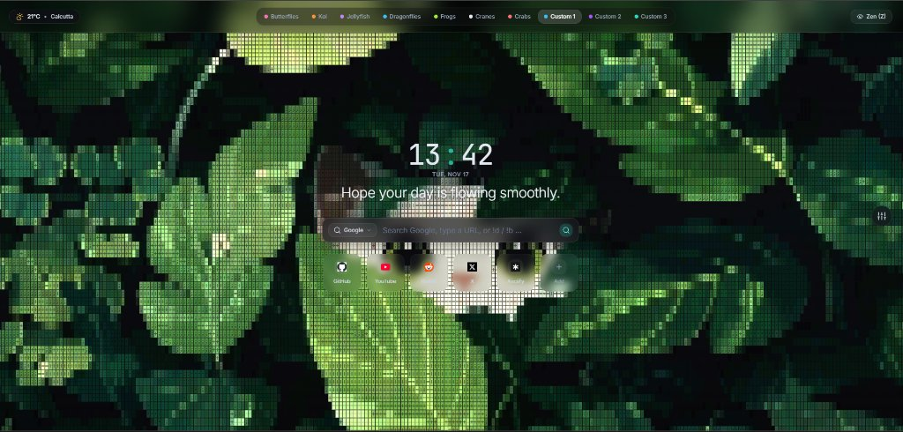
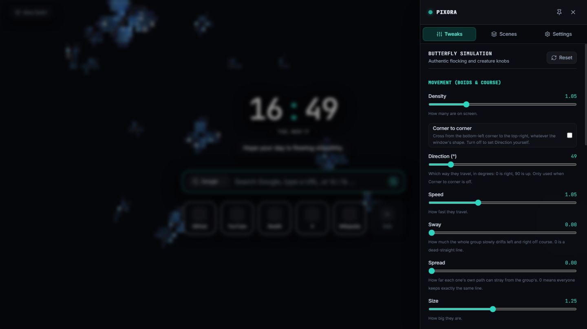

<div align="center">

```text
  ____  _                          
 |  _ \(_)_  _____  _ __ __ _      
 | |_) | \ \/ / _ \| '__/ _` |     
 |  __/| |>  < (_) | | | (_| |     
 |_|   |_/_/\_\___/|_|  \__,_|     
```

# Pixora

**An Immersive, Generative ASCII-Art Browser New Tab Sanctuary**

[](https://developer.chrome.com/docs/extensions/mv3/)
[](https://github.com/ColossalMonk/pixora/releases/latest)
[](https://react.dev/)
[](https://www.typescriptlang.org/)
[](LICENSE)

<br />



<br />
<br />

*Transforms your browser New Tab into an ambient, living digital habitat. Featuring authentic procedural wildlife simulations, real-time video and image ASCII transcoding with phosphor backlight glow, fluid Navier-Stokes gas flow, live Open-Meteo weather, and a distraction-free productivity suite.*

</div>

---

## Table of Contents

- [Overview](#overview)
- [Key Features](#key-features)
  - [1. Authentic Procedural Wildlife](#1-authentic-procedural-wildlife)
  - [2. Real-Time Video & Image ASCII Engine](#2-real-time-video--image-ascii-engine)
  - [3. Interactive Fluid Gas Flow & Traveling Ripples](#3-interactive-fluid-gas-flow--traveling-ripples)
  - [4. Complete Simulation & Media Tweaks Suite](#4-complete-simulation--media-tweaks-suite)
  - [5. Distraction-Free Productivity Overlay](#5-distraction-free-productivity-overlay)
- [Screenshots & Visuals](#screenshots--visuals)
- [Quick Start & Installation](#quick-start--installation)
  - [Method 1: Load Release Extension (Fastest)](#method-1-load-release-extension-fastest)
  - [Method 2: Build From Source](#method-2-build-from-source)
- [Keyboard Shortcuts](#keyboard-shortcuts)
- [Under the Hood / Architecture](#under-the-hood--architecture)
- [Privacy & Security](#privacy--security)
- [Credits & Acknowledgments](#credits--acknowledgments)
- [License](#license)

---

## Overview

**Pixora** completely replaces the default Chrome/Brave/Edge New Tab with a lightweight, high-performance canvas engine running at a smooth 60 FPS. 

Instead of static photos or cluttered promotional widgets, Pixora offers living procedural habitats and custom media canvases:
- **Wildlife Simulations** ported directly from [DesignerStephen1/ascii-animals](https://github.com/DesignerStephen1/ascii-animals).
- **Custom ASCII Media Slots** equipped with an in-browser ASCII video & image engine.

Every scene can be tuned in real-time, personalized with custom names, and switched instantly from a top-edge hover pill.

---

## Key Features

### 1. Authentic Procedural Wildlife

All animal behaviors, flocking algorithms, and vector shaders are ported directly without compromise:

| Species | Realistic Mechanics & Interactive Responses |
| :--- | :--- |
| **Butterflies** | Blue morpho polar-coordinate wing fans, flutter random walks, aerodynamic glides, and frantic scattering upon rapid pointer movement. |
| **Koi** | Five distinct Nishikigoi varieties with sinusoidal tail undulation, fin fluid dynamics, and natural schooling cohesion. |
| **Jellyfish** | Upward bell pulse contractions, trailing tentacle drag latency, bioluminescent glow, and escape pulses when startled. |
| **Dragonflies** | High-frequency wing buzzing, agile darting vectors, aerial hovering, and reactive cursor evasion. |
| **Frogs** | Patient breathing perches, blinking eyes, realistic parabolic leap trajectories with water splashes, and cursor gaze tracking. |
| **Cranes** | Majestic long-range V-formations with synchronized wingbeat cycles and altitude climbs when startled. |
| **Crabs** | Sideways coordinate scuttling, claw waving, and defensive shell tucking when approached. |

---

### 2. Real-Time Video & Image ASCII Engine

Upload photos or looping videos directly to create custom ASCII art backgrounds:

- **Full Video & Image Support**: Drop or upload any image (`.png`, `.jpg`, `.webp`) or video (`.mp4`, `.webm`, `.ogg`).
- **Real-Time Video ASCII Transcoding**: Hardware-accelerated frame sampling at 60 FPS converts video frames to ASCII with dynamic tone-mapping.
- **Phosphor Backlight Glow**: Phosphor luminescence simulation replicates the nostalgic ambiance of vintage monochromatic CRT monitors.
- **Custom Slot Naming**: Rename your custom slots (e.g. *"Cat in Leaves"*, *"Matrix Cyberpunk"*, *"Anime Ambient Loop"*). Names appear immediately on the top selection bar.
- **Render Modes**:
  - `Characters`: Classic ASCII density ramp (` .:-=+*#%@`).
  - `Braille`: High-density `2 × 4` dot matrices using Unicode Braille Patterns (`0x2800–0x28FF`).
  - `Tiles`: Solid-colored glyph tiles snapped to cell dimensions.
  - `Blocks`: Dual half-block vertical slicing (`▀`) for maximum resolution.
- **Color Themes**: True Color (24-bit RGB), Cyberpunk Neon, Phosphor Amber, Matrix Emerald, and Monochrome.

---

### 3. Interactive Fluid Gas Flow & Traveling Ripples

Pixora features a real-time 2D Navier-Stokes fluid physics simulation:

- **Fluid Gas Advection**: The cursor acts as a source of momentum, creating billowing smoke clouds, curling vortices, and expanding plumes that disperse across your wallpaper.
- **Concentric Traveling Ripples**: Switch to Ripple mode to see traveling water displacement waves that refract characters and wash across the screen with clicks and rapid cursor strokes.
- **Fine-Tuned Flow Controls**:
  - **Flow Velocity / Speed** (`0.2x – 3.0x`): Dictates fluid advection transport speed and ripple travel time.
  - **Gas Expansion / Plume Spread** (`0.2x – 3.0x`): Controls the lateral billowing expansion width and ripple wavelength.
  - **Flow Lingering / Dissipation** (`0.2x – 3.0x`): Adjusts how long smoke wisps or water ripples persist before fading.

---

### 4. Complete Simulation & Media Tweaks Suite

Click the gear icon on the top right (or press `S`) to slide out the Tweaks & Settings drawer:

1. **Movement Controls (Flocking & Boids)**:
   - Density (`0.1x – 4.0x`)
   - Corner-to-corner trajectory toggle
   - Manual Direction (`0° – 360°`)
   - Speed, Sway, and Spread
   - Size and Far Bias
   - Course Grip and Neighbour Separation
2. **Species-Specific Controls**:
   - Every individual knob from the original species file (e.g., *Wingspan*, *Flutter*, *Feelers*, *Tail wave*, *Glide*, *Fin size*, *Bell pulse*, *Tentacle lag*).
3. **Look, Grid & Shimmer**:
   - Hue Shift (`-180° to +180°`)
   - Iridescent Shimmer and White Sparkle rolls
   - Distance Fade / Atmospheric Fog
   - Trail duration and Trail Fade speed
   - Background Grid line visibility (`0x – 4x`)
   - ASCII Detail / Resolution scaling
4. **Custom Media Controls**:
   - Color Modes (True Color, Neon, Amber, Matrix, Monochrome)
   - Phosphor Backlight Glow (`0% – 100%`)
   - Brightness & Contrast correction
   - Fluid Gas Flow, Ripple, and Still pointer modes
   - Gas expansion plume spread, flow speed, and decay lingering
5. **Instant Reset to Default**:
   - One-click **Reset** button on simulation tweaks to restore default creature physics.
   - One-click **Reset** button on custom media to restore baseline visual fidelity while keeping slot names intact.
   - Comprehensive **Reset All to Default** button in Settings for a full factory refresh.

---

### 5. Distraction-Free Productivity Overlay

- **Top-Edge Hover Selection Pill**: Stays completely hidden off-screen until your mouse reaches the top-center edge.
- **Zen Mode**: Press `Z` or click the Zen button to instantly hide all UI elements, letting you enjoy the ambient simulation in full glory.
- **Conversational Frosted Greeting**: Floating frosted pill greeting that adapts to the time of day and features your custom name.
- **Live Open-Meteo Weather Widget**: Weather updates without API keys, supporting automatic device geolocation, custom cities (defaults to New Delhi), and °C / °F switching.
- **Universal Search**: Supports Google, DuckDuckGo, Bing, Brave, Ecosia, and Custom endpoints. Supports quick URL typing (`github.com`) and search engine bangs (`!g`, `!d`, `!b`).
- **Shortcuts Bar**: Bookmark bar with automatic favicon resolution and quick add/remove controls.
- **Accessibility & Motion**: Includes dedicated *Dim Art Behind Content* overlay, *Reduced Motion* mode, and live font size controls (`10px – 20px`).

---

## Screenshots & Visuals

<div align="center">

### Pixora in Action (Interactive Wildlife Sanctuary)


<br /><br />

### Live Simulation & Media Tweaks Suite


</div>

---

## Quick Start & Installation

### Method 1: Load Release Extension (Fastest)

1. Open the **[latest release](https://github.com/ColossalMonk/pixora/releases/latest)** and download the `pixora-v<version>-chrome-extension.zip` file under *Assets*.
2. Unzip the file into a permanent folder on your computer.
3. Open your browser extension management page:
   - **Google Chrome / Brave**: Navigate to `chrome://extensions`
   - **Microsoft Edge**: Navigate to `edge://extensions`
4. Enable **Developer mode** via the toggle in the top-right corner.
5. Click **Load unpacked** and select the unzipped folder (the one containing `manifest.json`).
6. Open a new tab (`Ctrl + T` / `Cmd + T`). When prompted to keep changes, select **Keep changes**.

---

### Method 2: Build From Source

```bash
# 1. Clone the repository
git clone https://github.com/ColossalMonk/pixora.git
cd pixora

# 2. Install dependencies
pnpm install
# or: npm install

# 3. Build the production extension
pnpm build
# or: npm run build

# 4. Package standalone zip
pnpm package:release
# or: npm run package:release
```

Once built, load the `dist/` directory as an unpacked extension in your browser.

---

## Keyboard Shortcuts

| Shortcut | Action |
| :---: | :--- |
| `Z` or `Esc` | Toggle **Zen Mode** (hides/reveals all UI widgets) |
| `S` | Open / Close the **Tweaks & Settings Drawer** |
| `/` | Immediately focus the **Central Search Bar** |
| `Esc` | Clear search input / close drawer when open |
| `Enter` | Execute search or navigate to typed URL |

---

## Under the Hood / Architecture

- **Canvas 2D Character Rasterizer**: Custom glyph-batching engine that clusters cells by color and alpha to minimize context state switches, easily pushing 60 FPS on high-DPI displays.
- **Semi-Lagrangian Fluid Gas Field**: Multi-scale Navier-Stokes solver using staggered bilinear sampling for continuous, silky advection without artifacting.
- **IndexedDB Media Vault**: Custom photos and video blobs are stored locally in the browser's IndexedDB (`pixora-media` database) without memory size limits.
- **Calm Zone**: animals fade softly behind the clock, search and shortcuts so text stays readable; Zen mode lifts it.
- **Zero Heavy External Dependencies**: Pure TypeScript mathematical models without bloated 3D libraries or external styling frameworks.

---

## Privacy & Security

- **100% Offline & Private**: Your photos, videos, and settings stay strictly on your local machine.
- **No Analytics / Telemetry**: Pixora contains zero tracking scripts, analytics beacons, or remote logging.
- **Open-Source APIs**: The only external HTTP requests are to Open-Meteo for live weather data and DuckDuckGo/Google for shortcut favicons.

---

## Credits & Acknowledgments

- **[ascii-animals](https://github.com/DesignerStephen1/ascii-animals)** by drewdi and Stephen Zhang (MIT): the animal simulations and renderer in `src/engine/ascii-animals/` are ported from it. Its licence is kept in [`src/engine/ascii-animals/LICENSE`](src/engine/ascii-animals/LICENSE) and [`THIRD_PARTY_NOTICES.txt`](THIRD_PARTY_NOTICES.txt), which also ships inside the extension zip.

---

## License

MIT © [ColossalMonk](https://github.com/ColossalMonk). See [LICENSE](LICENSE). Third-party code keeps its own licence (see above).
