# Pixora — An Immersive, Generative-Art Browser New Tab Experience

```text
  ____  _                          
 |  _ \(_)_  _____  _ __ __ _      
 | |_) | \ \/ / _ \| '__/ _` |     
 |  __/| |>  < (_) | | | (_| |     
 |_|   |_/_/\_\___/|_|  \__,_|     
  Generative ASCII-Art Browser New Tab • Manifest V3
```

> **Pixora** transforms the standard browser New Tab into an ambient, living digital sanctuary.  
> Combining a pure-math, 60-FPS procedural character simulation engine with a minimalist productivity suite inspired by **Claude's conversational warmth**, **Arc's fluid minimalism**, and **Linear's interaction polish**.

---

## Live Feature Highlights

```mermaid
graph LR
    subgraph Engine ["Original Procedural ASCII Engine"]
        E1["🌊 Underwater World (Boids & Jellyfish)"]
        E2["💧 Interactive Water (Wave Heightfield)"]
        E3["🐸 Frog & Pond (Biomechanical Kinematics)"]
        E4["🌌 Cosmic Aurora (Multi-Octave Simplex Noise)"]
        E5["🌀 Abstract Flow (Curl Noise Swarms)"]
    end

    subgraph Overlay ["Minimalist Productivity Overlay"]
        P1["💬 Time-Aware Conversational Greeting"]
        P2["🔍 Omni-Engine Search Bar ('/' Accelerator)"]
        P3["🔗 Pinned Shortcuts & Google Favicons"]
        P4["⛅ Ambient Weather & Typography Clock"]
        P5["🎨 Visual Palette & Character Customizer"]
        P6["🖼️ Image-to-ASCII Studio (Sobel Edge Filter)"]
    end

    Engine === Overlay
```



---

## 1. Five Signature Procedural Environments

Pixora features five completely original living worlds running on mathematical and physical simulations:

### 1. 🌊 Underwater World
- **Schooling Fish:** Craig Reynolds' Boids flocking with dynamic separation, alignment, and cohesion steering weights, plus secondary swimming tail undulation (`>`, `<`, `~`, `-`).
- **Kinematic Jellyfish:** Bell contractions with vertical propulsion and soft-body spring-chain tentacles with fluid drag.
- **Seabed Seaweed:** Stalks swaying with phase-lagged sinusoidal oscillations.
- **Atmospheric Caustics:** Procedural underwater light caustics computed via 3D continuous Simplex Noise.
- **Interactive Cursor Scattering:** Moving the mouse scatters schools of fish with exponential repulsion force.

### 2. 💧 Interactive Water & Ripples
- **Wave Heightfield Solver:** Discretized 2D shallow water wave equation ($u^{t+1} = 2u^t - u^{t-1} + c^2 \nabla^2 u$) with damping $\gamma = 0.985$.
- **Interactive Disturbances:** Cursor movements leave wake trails; clicks trigger Gaussian droplet shockwaves.
- **Floating Sakura Petals:** Cherry blossom petals drift across the surface and get pushed by wave height gradients.

### 3. 🐸 Frog & Lily Pond
- **Biomechanical Frog State Machine:** Frogs exhibit realistic states (Breathing $\rightarrow$ Jump anticipation $\rightarrow$ Parabolic ballistic leap $\rightarrow$ Splashdown $\rightarrow$ Swimming $\rightarrow$ Return to lily pad).
- **Physical Splash Coupling:** Frogs take off and land with localized water ripple energy injected into the wave equation solver.
- **Buzzing Dragonflies:** Dynamic insects hovering and darting across the water surface.

### 4. 🌌 Cosmic Aurora
- **Multi-Octave Noise Curtains:** Simplex Noise ribbon curtains oscillating with continuous time-varying folds.
- **Atmospheric Gradient:** Transitions from emerald green (`#10E6A0`) at the curtain base to glowing magenta/violet (`#C03CF0`) at the crown.
- **Twinkling Starfield:** Background cosmos populated with starlight glyphs (`✦`, `✧`, `·`, `°`, `•`).

### 5. 🌀 Abstract Flow Fields
- **Continuous Curl Noise Swarms:** Mathematical generative particles steered by 3D procedural noise velocity grids.
- **Dynamic Mouse Vortex Attractor:** Cursor creates an inward pull and tangential swirl force, pulling particles into a living vortex.
- **Directional Vectors:** Velocity vectors map in real-time to directional Unicode glyphs (`→`, `↗`, `↑`, `↖`, `←`, `↙`, `↓`, `↘`).

---

## 2. Image-to-ASCII Conversion Studio

Transform your own pictures into retro character artwork:
- **Client-Side Offscreen Processing:** Full aspect-ratio compensation (0.55 monospace scale) for 50 to 160 columns.
- **Sobel 3×3 Edge Contour Filter:** Computes edge gradient magnitude and angle, mapping contours to structural stroke characters (`/`, `|`, `\`, `-`).
- **Flexible Character Ramps:** Render in classic 10-level ASCII, dense 70-character ramps, Unicode blocks, or geometric symbols.
- **One-Click Export:** Copy directly to clipboard or download as a standalone `.txt` document.

---

## 3. Minimalist Productivity Suite

- **Claude-Inspired Conversational Greeting:** Time-aware greetings (Morning, Afternoon, Evening, Night) with personalized username integration.
- **Omni-Engine Search Bar:** Instant switching between **Google**, **DuckDuckGo**, **Bing**, **Brave Search**, **Ecosia**, or a **Custom Search URL**.
- **Keyboard Accelerators:** Press `/` anywhere to focus search immediately; `Esc` to blur or close dialogs.
- **Pinned Shortcuts:** Fast access to your favorite sites with automated high-resolution Google S2 favicon fetching.
- **Ambient Typography Clock & Weather:** Live local time and free Open-Meteo weather with automatic geocoding and 30-minute caching.
- **Personalization Drawer:** Customize font sizes, character density, animation speed, background dimming, and color themes.

---

## 4. Visual Themes & Character Sets

| Theme | Aesthetic & Color Spectrum |
| :--- | :--- |
| **True-Color** | Full RGB atmospheric gradient per environment |
| **Phosphor Amber** | CRT Terminal Amber (`#F59E0B` & `#B45309`) |
| **Matrix Emerald** | Classic digital hacker phosphor green (`#22C55E`) |
| **Cyberpunk Neon** | Vibrant synthwave magenta & cyan (`#EC4899` & `#38BDF8`) |
| **Ice Blue** | Arctic deep sea and glacial azure (`#0E7490` & `#38BDF8`) |
| **Claude Warm** | Warm terracotta (`#D97757`) & oatmeal cream |
| **Monochrome White** | Clean slate typography (`#F1F5F9`) |

---

## Installation & Setup

### Option 1: Load as Unpacked Extension in Chrome / Edge / Brave

1. Download or clone this repository:
   ```bash
   git clone https://github.com/ColossalMonk/pixora.git
   cd pixora
   ```
2. Install dependencies and compile the production extension:
   ```bash
   pnpm install
   pnpm build
   # or with npm:
   # npm install
   # npm run build
   ```
3. Open your browser extension management page:
   - **Google Chrome / Brave:** `chrome://extensions`
   - **Microsoft Edge:** `edge://extensions`
4. Enable **"Developer mode"** in the top right.
5. Click **"Load unpacked"** and select the `pixora/dist` folder.
6. Open a new tab (`Ctrl + T` / `Cmd + T`) to experience Pixora!

---

### Option 2: Build a Standalone Release ZIP

Pixora includes an automated packaging script:
```bash
pnpm package:release
# or: npm run package:release
```
This builds the extension and generates `release/pixora-v1.0.0-chrome-extension.zip`, ready for distribution or GitHub Releases.

---

### Option 3: Local Development Server

Run the development server with instant Hot Module Replacement (HMR):
```bash
pnpm dev
# or: npm run dev
```
Preview at `http://localhost:5173`.

---

## Keyboard Shortcuts

| Shortcut | Action |
| :--- | :--- |
| `/` | Focus Central Search Bar |
| `Esc` | Blur Search Bar / Close active drawer or modal |
| `Enter` | Submit query to selected search engine |
| `Click Canvas` | Inject shockwave water ripple / splash |
| `Hover Canvas` | Displace fish schools / create water wakes / attract particles |

---

## Architecture & Performance Safeguards

- **60 FPS Decoupled Canvas Loop:** The simulation runs in pure TypeScript without triggering React re-renders or DOM reflows.
- **Zero Inactive Tab CPU ($0.0\%$):** Automatically binds `visibilitychange` to suspend the RequestAnimationFrame loop when the tab is inactive, preventing battery drain.
- **Euclidean Geometry Compensation:** Aspect ratio normalizer accounts for rectangular monospace font proportions ($0.6\times$), guaranteeing ripples and circular bodies remain true circles.
- **Hybrid Storage Layer:** Transparently uses `chrome.storage.local` inside the extension, with automatic fallback to `localStorage` during standard web development.

For the full mathematical formulations, component diagrams, and memory budgets, see [ARCHITECTURE.md](./ARCHITECTURE.md).

---

## License

MIT © [ColossalMonk](https://github.com/ColossalMonk)
